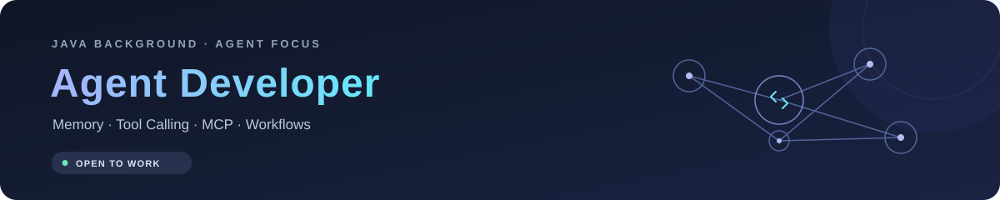

  

  <b>Hi, I'm cinfly · Open to Agent Development Roles</b> 
  From Java backend development to AI agents — connecting memory, tools, and workflows.

  

### 🧠 About Me

- **Agent Development** · Familiar with agent workflows, memory mechanisms, tool calling, and MCP, with a focus on how they work together in practice.
- **Development Background** · Previously focused on learning Java backend development; now working with Python / Java, with frontend foundations in JavaScript, TypeScript, and Vue.
- **Continuous Learning** · Use Claude Code and Codex, and actively follow new tools, frameworks, and practices in the agent ecosystem.

### 🛠 Tech Stack

| Area | Technologies & Tools |
| :--- | :--- |
| Frontend |    |
| Backend |   |
| Agent |    |

  <a href="mailto:cinfly_e2e@qq.com">📫 cinfly_e2e@qq.com</a> ·
  <a href="https://github.com/siisjsjii">GitHub</a> 
  Happy to connect about agent development, engineering practices, and career opportunities.

